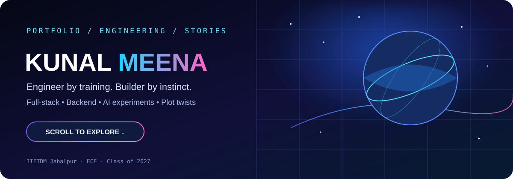
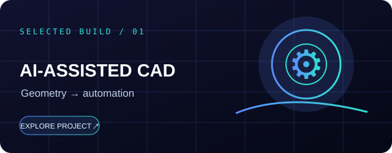
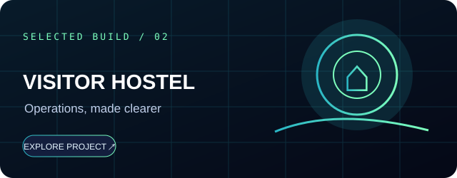
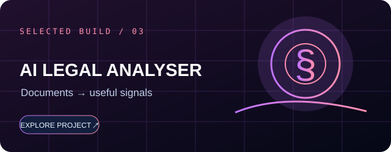
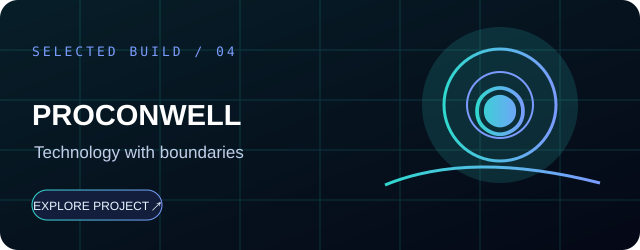
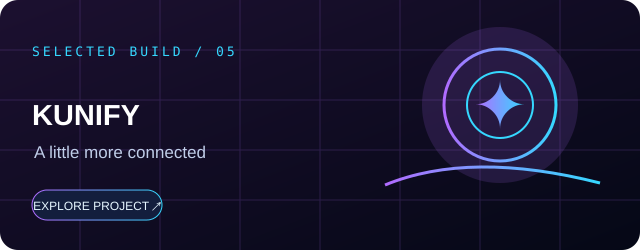
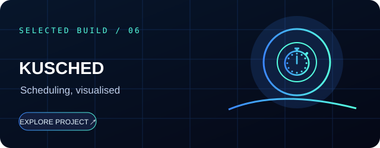
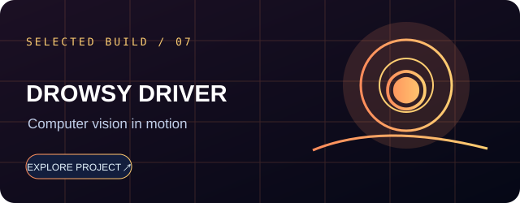
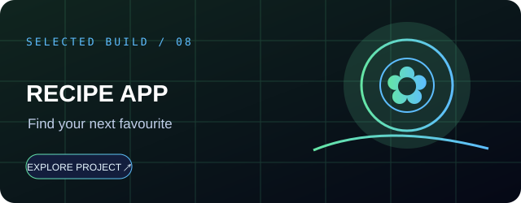

<div align="center">



<a href="https://kunalmeena.me"></a>
<a href="mailto:kunalmeena1311@gmail.com"></a>
<a href="https://linkedin.com/in/Kunal8859"></a>


<p>
<a href="#-quick-navigation">Navigate</a> ·
<a href="#-choose-your-adventure">Projects</a> ·
<a href="#-stack-loadout">Stack</a> ·
<a href="#-the-journey">Journey</a> ·
<a href="#-achievements-unlocked">Achievements</a> ·
<a href="#-open-a-portal">Contact</a>
</p>

</div>

---

## 🧭 Quick navigation

| If you're here to... | Jump to |
|---|---|
| See what I build | [Project multiverse](#-choose-your-adventure) |
| Check my engineering toolkit | [Stack loadout](#-stack-loadout) |
| Understand my experience | [The journey](#-the-journey) |
| See milestones | [Achievements unlocked](#-achievements-unlocked) |
| Find the human outside code | [Beyond the terminal](#-beyond-the-terminal) |
| Talk about an opportunity | [Open a portal](#-open-a-portal) |

<details>
<summary><b>⌁ Boot sequence — click to reveal</b></summary>

```console
kunal@universe:~$ whoami
Kunal Meena

kunal@universe:~$ cat mission.txt
Build useful software.
Automate the repetitive.
Keep learning.
Never lose the human side.

kunal@universe:~$ echo $STATUS
BUILDING // LEARNING // ITERATING
```
</details>

## 👨‍🚀 The human behind the keyboard

I'm an Electronics & Communication Engineering student at **PDPM IIITDM Jabalpur**, graduating in 2027. I like working where software engineering, automation, and applied AI meet real-world problems.

My favourite part isn't adding another technology to a résumé. It's turning an unclear workflow into a tool that is understandable, useful, and dependable.

- 🧩 I like starting with the problem, not the trend.
- 🛠️ I care about APIs, maintainability, edge cases, and useful logs.
- 🌱 I learn by building, testing, and improving.
- ✍️ Outside code, I write fiction, perform theatre, take photographs, listen to music, and learn Japanese.

> **Engineer by training. Builder by instinct. Author by plot twist.**

---

## 🪐 Choose your adventure

*Eight builds. Different problems. Click a card to visit its project.*

<table>
<tr>
<td width="50%" valign="top">
<a href="https://github.com/Kunal88591"></a>

**01 · AI-assisted CAD automation**

Python-driven CAD workflow automation, assembly handling, and STEP export.

`Python` `Creo` `Creoson` `FreeCAD`

[**Open project ↗**](https://github.com/Kunal88591)
</td>
<td width="50%" valign="top">
<a href="https://github.com/Kunal88591/VH_Management_IIITDMJ"></a>

**02 · Visitor Hostel Management**

Campus visitor-management workflow with role-based access and deployment tooling.

`Node.js` `Express` `MongoDB` `JWT` `Nginx`

[**Repository ↗**](https://github.com/Kunal88591/VH_Management_IIITDMJ) · [**Live system ↗**](https://vh.iiitdmj.ac.in)
</td>
</tr>
<tr>
<td width="50%" valign="top">
<a href="https://github.com/Kunal88591/AI-Legal-Document-Analyser"></a>

**03 · AI Legal Document Analyser**

Document ingestion, entity extraction, semantic representations, and relevance scoring.

`Python` `spaCy` `Embeddings` `React` `PostgreSQL`

[**Repository ↗**](https://github.com/Kunal88591/AI-Legal-Document-Analyser)
</td>
<td width="50%" valign="top">
<a href="https://github.com/Kunal88591/Privacy-Focused-Context-Aware-Digital-Wellbeing-System"></a>

**04 · ProConWell / FocusMate**

A privacy-focused wellbeing concept exploring context-aware assistance and on-device inference.

`Python` `TensorFlow Lite` `FastAPI` `MQTT` `React Native`

[**Repository ↗**](https://github.com/Kunal88591/Privacy-Focused-Context-Aware-Digital-Wellbeing-System)
</td>
</tr>
<tr>
<td width="50%" valign="top">
<a href="https://github.com/Kunal88591/Kunify"></a>

**05 · Kunify**

A modern web application built with a React/Next.js ecosystem and Supabase-backed features.

`Next.js` `React` `Supabase` `Tailwind CSS`

[**Repository ↗**](https://github.com/Kunal88591/Kunify)
</td>
<td width="50%" valign="top">
<a href="https://github.com/Kunal88591/KuSched"></a>

**06 · KuSched**

A C++ CPU scheduling simulator exploring classic scheduling policies, preemption, and feedback queues.

`C++` `Operating Systems` `Algorithms`

[**Repository ↗**](https://github.com/Kunal88591/KuSched)
</td>
</tr>
<tr>
<td width="50%" valign="top">
<a href="https://github.com/Kunal88591/Drowsiness-Detection-EAR-MAR"></a>

**07 · Drowsiness detection**

A computer-vision experiment using facial landmarks and EAR/MAR signals to explore driver drowsiness.

`Python` `OpenCV` `MediaPipe`

[**Repository ↗**](https://github.com/Kunal88591/Drowsiness-Detection-EAR-MAR)
</td>
<td width="50%" valign="top">
<a href="https://github.com/Kunal88591/Kunal_Recipe_App"></a>

**08 · Recipe app**

A Django recipe application designed to make browsing and discovering recipes straightforward.

`Django` `JavaScript` `HTML/CSS`

[**Repository ↗**](https://github.com/Kunal88591/Kunal_Recipe_App)
</td>
</tr>
</table>

<div align="center">

<a href="https://kunalmeena.me"></a>

</div>

<details>
<summary><b>🔍 Project index — compact mode</b></summary>

| Project | Focus | Link |
|---|---|---|
| AI-assisted CAD automation | CAD tooling and workflow automation | [Explore](https://github.com/Kunal88591) |
| Visitor Hostel Management | Full-stack operations | [Explore](https://github.com/Kunal88591/VH_Management_IIITDMJ) |
| AI Legal Document Analyser | NLP and document processing | [Explore](https://github.com/Kunal88591/AI-Legal-Document-Analyser) |
| ProConWell / FocusMate | Privacy-focused digital wellbeing | [Explore](https://github.com/Kunal88591/Privacy-Focused-Context-Aware-Digital-Wellbeing-System) |
| Kunify | Modern web application | [Explore](https://github.com/Kunal88591/Kunify) |
| KuSched | CPU scheduling simulator | [Explore](https://github.com/Kunal88591/KuSched) |
| Drowsiness Detection | Computer vision | [Explore](https://github.com/Kunal88591/Drowsiness-Detection-EAR-MAR) |
| Recipe App | Django web application | [Explore](https://github.com/Kunal88591/Kunal_Recipe_App) |

</details>

---

## 🧰 Stack loadout

| Skill zone | Tools in my toolbox |
|---|---|
| **Languages** | Java · Python · C++ · JavaScript · TypeScript · SQL |
| **Frontend** | React · Next.js · HTML · CSS · Tailwind CSS · React Native |
| **Backend** | Node.js · Express · Spring Boot · FastAPI · Django · Flask |
| **Databases** | PostgreSQL · MySQL · MongoDB · Redis · Supabase · Firebase |
| **AI / Vision** | scikit-learn · TensorFlow Lite · OpenCV · MediaPipe · spaCy · embeddings |
| **Developer tools** | Git · Linux · Docker · Nginx · PM2 · Postman |
| **CAD automation** | Creo · Creoson · FreeCAD · Python tooling |

<details>
<summary><b>🧪 My build loop</b></summary>

```text
01  Understand the actual problem
02  Build the smallest useful version
03  Test edge cases and failure paths
04  Improve observability and usability
05  Ship → learn → iterate
```
</details>

---

## 📊 The GitHub arcade

<div align="center">

<a href="https://github.com/Kunal88591">

</a>
<a href="https://github.com/Kunal88591">

</a>


<a href="https://github.com/Kunal88591">

</a>

</div>

<sub>Stats are generated by external services. They can load slowly, be rate-limited, or temporarily fail. Counts are live and may change.</sub>

---

## 🧭 The journey

<table>
<tr><td><b>Aug 2023 – May 2027</b></td><td>🎓 <b>PDPM IIITDM Jabalpur</b><br/>B.Tech, Electronics & Communication Engineering</td></tr>
<tr><td><b>Apr – May 2025</b></td><td>🤖 <b>Edunet Foundation · Microsoft–AICTE initiative</b><br/>AI / ML learning experience with computer-vision and deep-learning exposure</td></tr>
<tr><td><b>Apr – Sep 2026</b></td><td>🛠️ <b>Floneo Technologies</b><br/>Software development internship across backend engineering, full-stack work, and CAD automation</td></tr>
<tr><td><b>CAD automation project</b></td><td>⚙️ <b>CEN Technologies, Kochi</b><br/>CAD automation project involving AI-assisted design workflows</td></tr>
</table>

---

## 🏆 Achievements unlocked

<div align="center">

| 🥇 NPTEL | 💡 OkCredit | 🎭 Theatre |
|---|---|---|
| **Gold + Elite** | **Top 7 / 757 teams** | **National-level events** |
| Java Programming · 94% | Future Founders · first in adoption stage | Street-play recognition with *Jazbaat* |

</div>

- 📚 Published fiction author.
- 🧠 Practising DSA and strengthening software engineering fundamentals.
- 🧪 Participated in hackathon and innovation challenges, including HMEL Energy Quest 3.0.

---

## 📚 One plot twist: I wrote a novel

<div align="center">

### *The Ideal Man*

A fiction story about love, loss, choices, and the versions of ourselves we never show the world.

<a href="https://store.pothi.com/book/kunal-meena-ideal-man/"></a>

</div>

Writing fiction reminds me that engineering and storytelling share a rule: **care about the person on the other side.**

---

## 🎮 Beyond the terminal

<table>
<tr>
<td align="center" width="25%">🇯🇵<br/><b>Japanese</b><br/><sub>A new phrase at a time</sub></td>
<td align="center" width="25%">📷<br/><b>Photography</b><br/><sub>Collecting little moments</sub></td>
<td align="center" width="25%">🎧<br/><b>Music</b><br/><sub>Soundtrack for the build</sub></td>
<td align="center" width="25%">🎭<br/><b>Theatre</b><br/><sub>Stories beyond the screen</sub></td>
</tr>
</table>

---

## 🪄 The developer experience

<details>
<summary><b>⚠️ Known issue: “I'll fix one tiny bug”</b></summary>

```text
Me: I'll fix one tiny bug.

Three hours later:
  ├── refactored the API
  ├── redesigned the component
  ├── opened 17 documentation tabs
  ├── started learning a new framework
  └── forgot the original bug

Status: works on my machine. Probably.
```

**The bug was one line. The learning was priceless.** 😅
</details>

<details>
<summary><b>🧠 Engineering principles</b></summary>

- Build for people, not just screenshots.
- Prefer clarity over cleverness.
- Treat failures as information.
- Automate boring work when it makes sense.
- Keep learning; stay kind.

</details>

---

## 🌌 Open a portal

Interested in software engineering, backend systems, full-stack development, automation, applied AI, internships, or building something interesting? Let's talk.

<div align="center">

<a href="mailto:kunalmeena1311@gmail.com"></a>
<a href="https://linkedin.com/in/Kunal8859"></a>
<a href="https://github.com/Kunal88591"></a>
<a href="https://kunalmeena.me"></a>

<br/><br/>


<sub>Made with curiosity, caffeine, and a suspicious number of open tabs.</sub>

</div>
